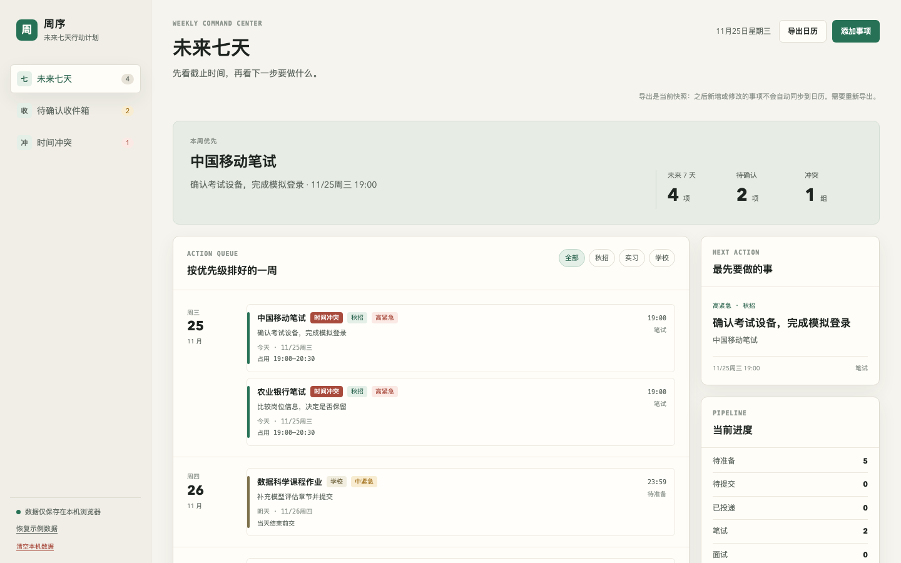
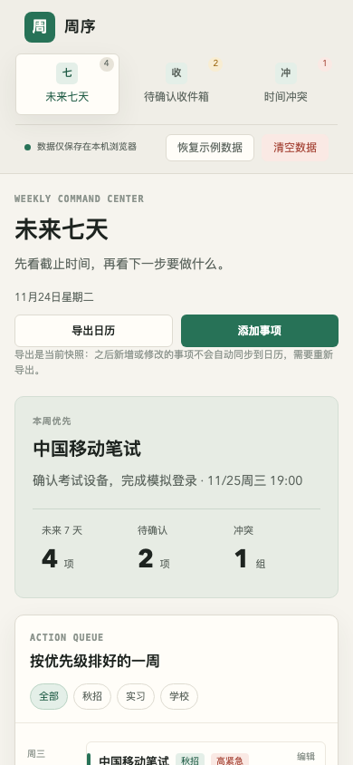

# 周序 Zhouxu

面向求职学生的截止时间管理原型。把招聘、课程和实习里散落在群聊、公众号、邮件和截图中的
日期，整理成一张可执行的未来七天行动计划。

> **一句话定位**：它不是日历的替代品，是日历的前置环节——把非结构化的招聘信息，
> 翻译成带原文依据的时间承诺，并在两个岗位撞车时帮用户做取舍。



## 为什么做这个

深访中发现的真实状态：招聘信息以非结构化形式到来（公众号长图、群聊截图、邮件通知），
截止日期要么藏在正文里，要么写"即日起招满即止"，要么根本没有。
求职学生把节点记在聊天记录和脑子里，一周漏掉或撞车是常态。

通用日历假设用户已经知道要记什么、什么时候；招聘平台只关心自己平台内的投递。
中间那一段——**从非结构化信息到带依据的时间承诺**——是周序试着占的位置。

## 做了什么

```
粘贴文本或选择截图
→ 解析标题与日期（结果需人工确认）
→ 展示日期推算依据与待确认字段
→ 生成未来七天安排
→ 发现冲突并并排比较
→ 导出 .ics
```

| 能力 | 说明 |
| --- | --- |
| 中文相对日期推算 | 今天 / 明天 / 后天 / N 天后 / 本周 X / 下周 X / 月底 / 11 月 25 日等，推算结果永远附原文依据等待确认 |
| 标题提取 | 一句话里取出事项本身（"下周一交数据分析报告" → "交数据分析报告"）|
| 缺失日期不编造 | 原文没日期就显示"未找到截止日期"，进入待跟进区而不是硬造一个日期 |
| 模糊表达单独标注 | 同一页既有明确时刻又有"招满即止"时，只按明确时刻入库，模糊表述单独提示 |
| 未来七天视图 | 按截止时间、具体任务、紧急程度排序；超期与无日期分区展示，不静默丢弃 |
| 冲突并排比较 | 两个岗位同时段撞车时并排展示岗位上下文，由用户标记优先，不自动取舍 |
| `.ics` 导出 | 提前 3 天与提前 1 天提醒；无具体时刻导出为全天事件；附"核对截止日期"提醒 |
| 本地优先 | 零依赖、零账号，数据只存在浏览器本地，截图不上传 |

## 怎么跑

```bash
python3 -m http.server 4173 --directory mvp
```

打开 `http://127.0.0.1:4173`。手机访问用电脑的局域网 IP，手机与电脑需在同一 Wi-Fi。

线上版本见 <https://sevenbeans.github.io/zhouxu/>。

## 验证方式

多视口与交互检查是脚本化的，可复现：

```bash
python3 qa/run_qa.py
```

脚本通过 Chrome DevTools Protocol 在 6 个视口宽度下真实加载页面，
读取 `scrollWidth` 与所有元素的 `getBoundingClientRect()`，
同时采集控制台错误。最新一次结果：6 个视口均无横向滚动、无元素越界、控制台无错误。



## 研究与文档

研究已完成收口，全部文档在 [`outputs/`](./outputs/)：

| 文档 | 内容 |
| --- | --- |
| [04 项目 Brief](./outputs/04_项目Brief_v1.md) | 目标用户、核心问题、关键假设 |
| [16 研究结论 v2](./outputs/16_研究结论_02_2026-11-17.md) | 研究结论与产品取舍 |
| [23 单用户任务记录 01](./outputs/23_单用户任务记录_01_2026-11-20.md) | 首次真实任务测试，耗时与原话 |
| [27 样本集 v1](./outputs/27_样本集v1_2026-11-24.md) | 6 张真实截图与逐张判断规则 |
| [28 桌面端与移动端 QA](./outputs/28_桌面端与移动端QA_2026-11-24.md) | 6 视口检查、问题修复与复验 |
| [30 试用回看记录 01](./outputs/30_试用回看记录_01_2026-11-24.md) | 回看发现与产品改动 |
| [31 部署方案与链接](./outputs/31_部署方案与链接_2026-11-24.md) | 部署路径与访问方式 |

## 证据边界

这一节是本项目最重要的部分，请认真读：

- 研究对象是 **1 名目标用户**，完成了 3 轮文字深访、1 次补充回访、1 次真实任务测试和 1 次试用回看。
- **不构成多人可用性验证**，不代表留存率或满意度。
- **没有接入真实 OCR 或视觉模型**。图片输入进入待人工确认队列，示例标签是人工整理的演示数据。
- **不宣称任何识别准确率**。样本集只有 6 张，评测按"原文无日期而未生成日期算正确"的口径，
  结论只能表述为"在本样本集上"。
- 不做自动提交网申、岗位适配度评分、AI 自动判断"是否已投递"。
- 导出的日历是**当前快照**，不做双向同步。

## 技术说明

零依赖、零构建步骤，纯 HTML / CSS / JavaScript，状态存 `localStorage`。
`mvp/parser.js` 提供三个不依赖网络模型的纯函数：

```js
ZhouxuParser.parseDateExpression(text, today);  // 日期、匹配片段、推算依据
ZhouxuParser.parseTimeExpression(text);        // 时刻与匹配片段
ZhouxuParser.extractTitle(text);               // 从一句话里取出事项名称
```

`scripts/build_deploy.sh` 从 `mvp/` 生成 `docs/` 发布目录，保证线上版本与开发版一致。

## 目录

```text
mvp/        原型源码（开发版）
docs/       GitHub Pages 发布目录（由脚本生成，勿手改）
outputs/    研究、样本、QA 与试用记录
work/       截图样本、元数据与 QA 截图
qa/         多视口自动化检查脚本
scripts/    构建脚本
```

## 如何更新线上版本

线上地址固定为 <https://sevenbeans.github.io/zhouxu/>，**改动不会改变网址**。
它是静态站点，地址绑定的是仓库而不是某次构建，推送后 GitHub 自动重新发布，通常 30 秒内生效。

```bash
# 1. 改 mvp/ 里的文件
# 2. 生成发布目录（这一步不能省，否则推上去的还是旧版本）
./scripts/build_deploy.sh
# 3. 提交并推送
git add -A && git commit -m "描述这次改了什么"
git push
```

改过 `index.html`、`styles.css`、`app.js` 或 `parser.js` 时，
记得把 `index.html` 里的版本号 `?v=YYYYMMDD-N` 往上加一位，
否则浏览器可能还在用缓存里的旧文件。
